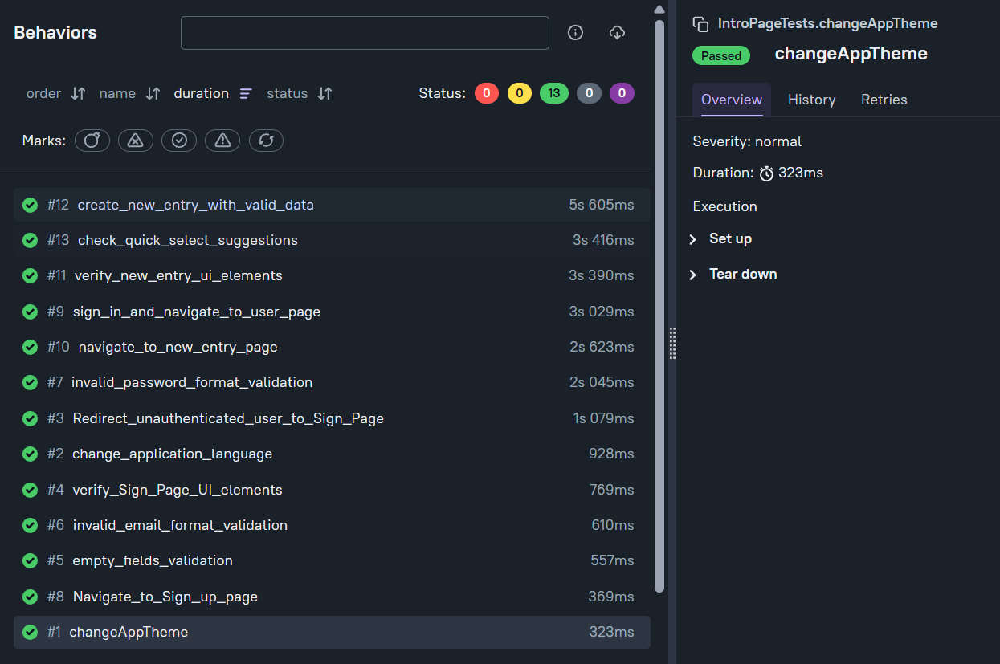
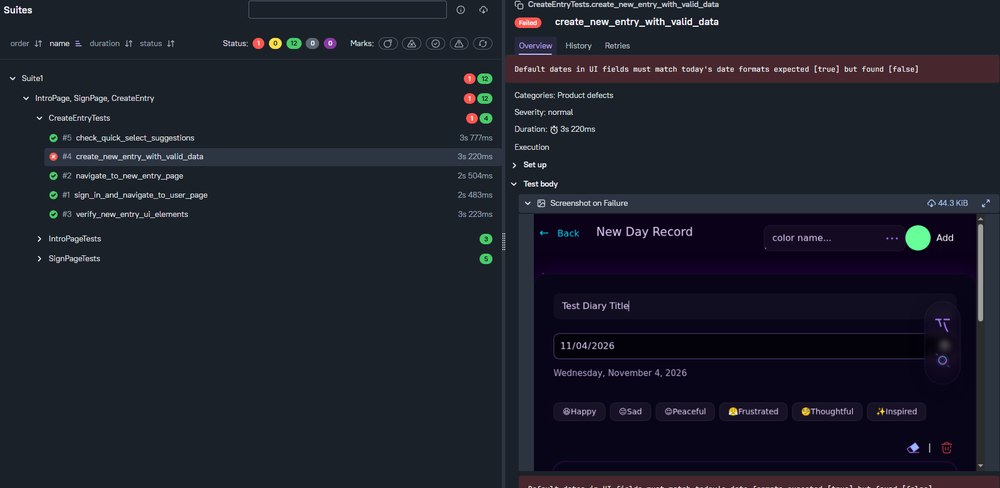
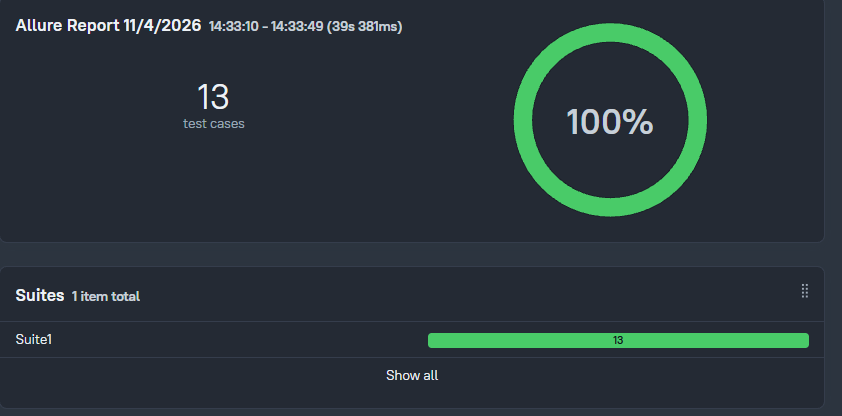
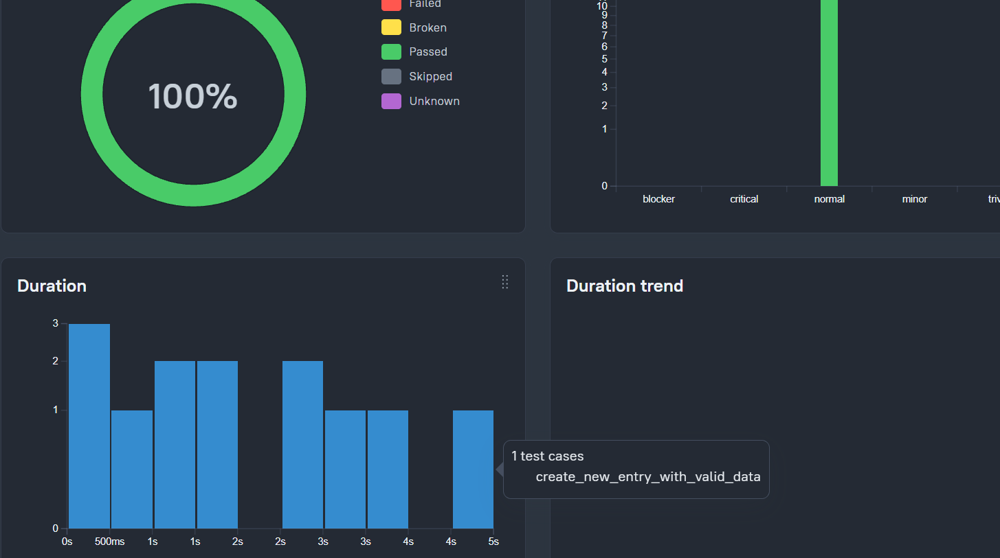
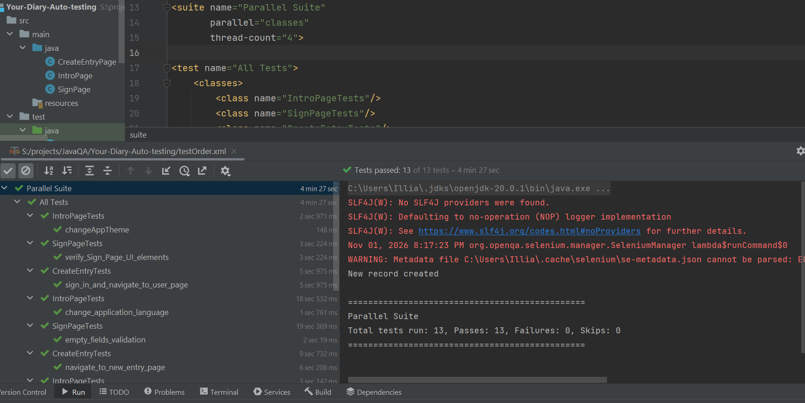
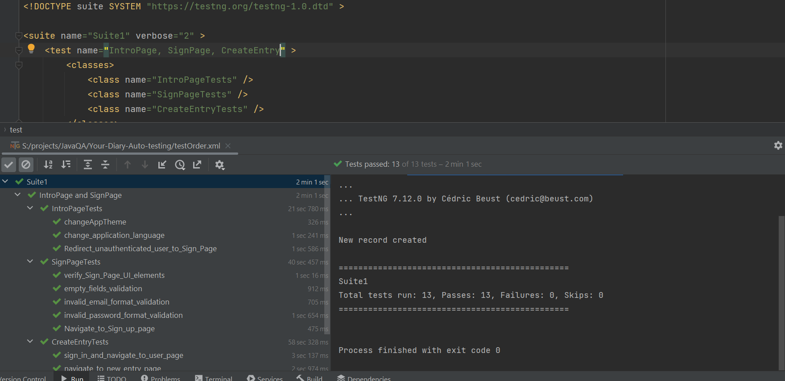
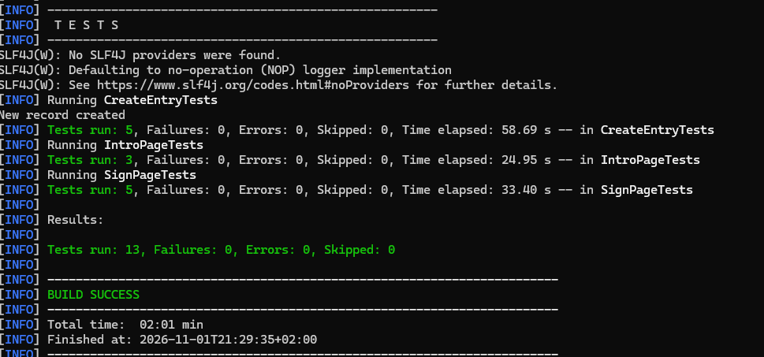

[Test Allure Report](https://ilkarion.github.io/Your-Diary-Auto-testing/) - auto genereted report from testing. Connected to [YourDiary](https://github.com/Ilkarion/diary_cosmic) project. 
Any update for my code here or to my [project](https://github.com/Ilkarion/diary_cosmic) will execute all automation testing and generetes report.

This is my automation QA project for my Fullstack app [YourDiary](https://github.com/Ilkarion/diary_cosmic)

Java + Selenium + TestNG + Maven + test report: allure

[Test Cases](https://github.com/Ilkarion/Your-Diary-Auto-testing/blob/main/test-cases.md) - [learned_new_stuff](https://github.com/Ilkarion/Your-Diary-Auto-testing/blob/main/i_learned.md) - [created_classes_code](https://github.com/Ilkarion/Your-Diary-Auto-testing/tree/main/src/main/java) - [tests_autom_execution_code](https://github.com/Ilkarion/Your-Diary-Auto-testing/tree/main/src/test/java)

## Example of **report** from Allure 

:-------------------------:|:-------------------------:
Passed report        |  Attached image to bug by script
:-------------------------:|:-------------------------:
 | 
:-------------------------:|:-------------------------:
Passed summary report        |  Graphs
:-------------------------:|:-------------------------:
 | 
4 Stream testing       |  1 Stream testing
:-------------------------:|:-------------------------:
 | 
Test from cmd      |  
:-------------------------:|:-------------------------:
 | 
